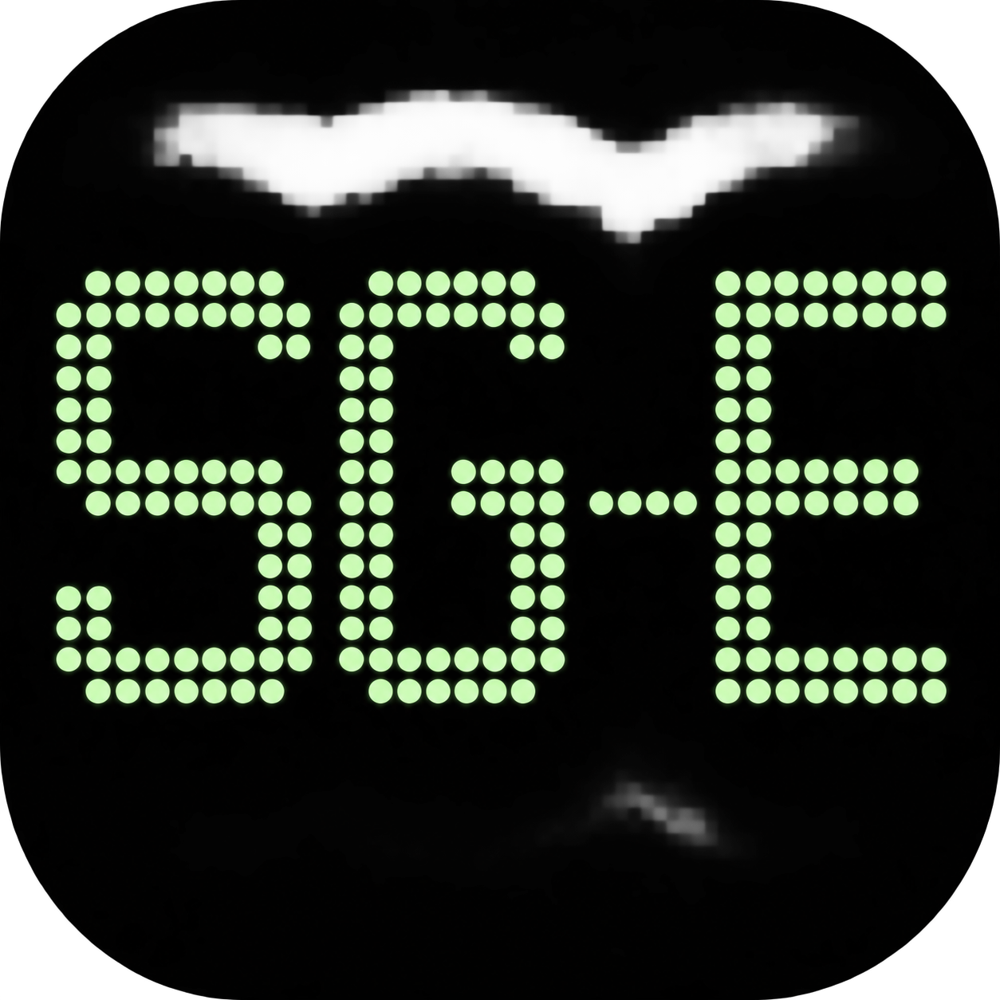
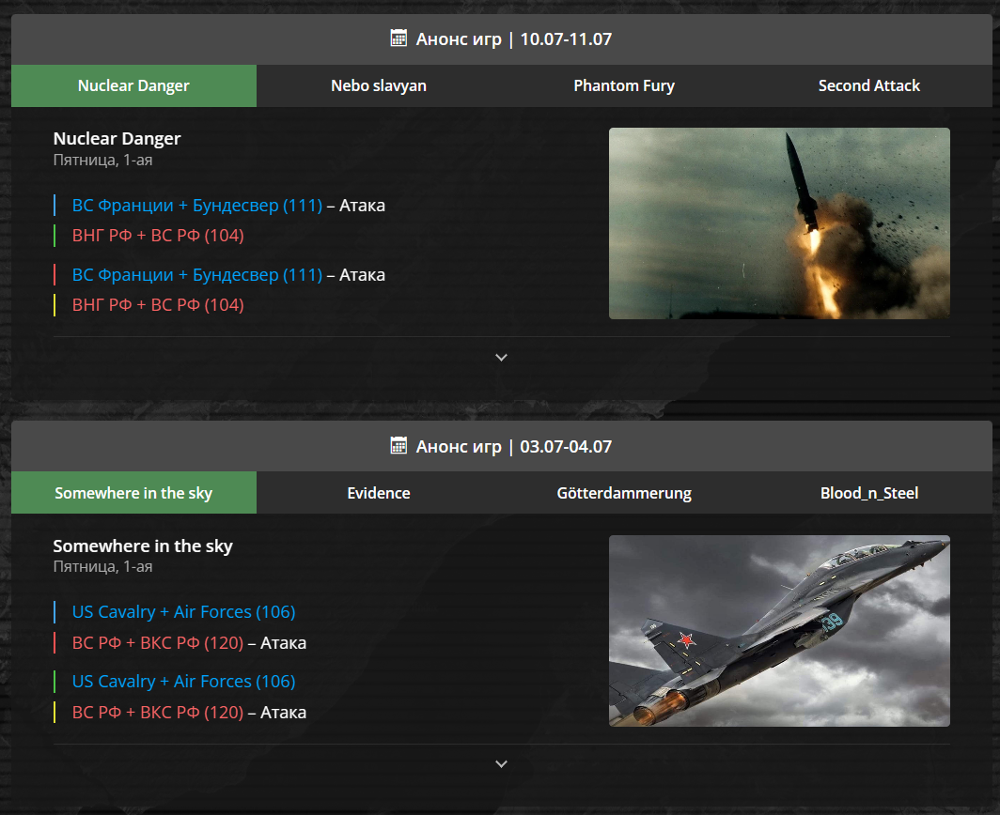

  

<h1 align="center">sg.zone-enhancements</h1>

<strong><a href="https://github.com/Combain-The-Low-Skill/sg.zone-enhancements/releases/tag/v1.0.2">v1.0.2</a> · Автор: Combain (C-T-LS)</strong>

## Функционал

- Кастомные вид постов анонсов миссий.
- Навигация форума: заголовки тем ведут к последнему сообщению; области раздела и последней темы кликаются отдельно.
- Адаптивный интерфейс, плавное переключение миссий и переходы между страницами в поддерживаемых браузерах. Учитывается системная настройка уменьшения движения.
- Обработка блоков, появляющихся при динамическом обновлении страницы.

## Установка

1. Скачайте репозиторий (Code → Download ZIP) и распакуйте архив.
2. Откройте `chrome://extensions` и включите **Режим разработчика**.
3. Нажмите **Загрузить распакованное расширение** и выберите папку с `manifest.json`.
4. Откройте или перезагрузите `https://sg.zone/`.

После обновления файлов нажмите кнопку обновления расширения и перезагрузите сайт. Для возврата исходного интерфейса отключите расширение и перезагрузите страницу.

---

